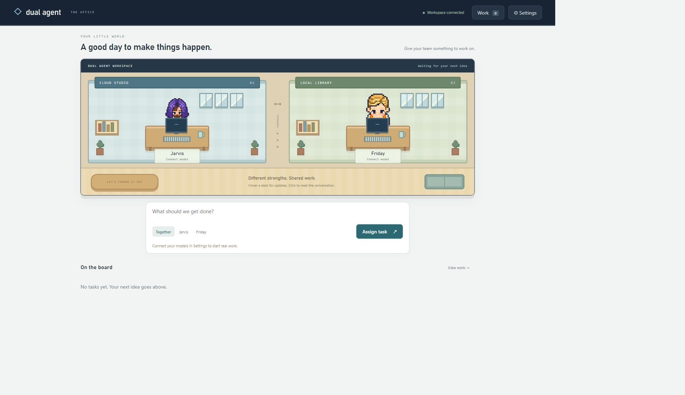

# Jarvis Meets Friday

Jarvis Meets Friday is a personal two-agent office and cloud-computing prototype. Jarvis is the cloud operator; Friday is the evidence steward and peer reviewer, using its separately configured model API; a Python laptop companion indexes selected private documents locally and releases only owner-reviewed excerpts. Assign work to Jarvis, Friday, or the team from the dashboard. Team tasks let the operator and steward coordinate through shared task chat and, when configured, Friday reviews Jarvis's draft. The dashboard has a single Settings area for models, keys, budgets, and connections.

The Worker and Durable Object run the office and persist task state. A separate Linux Docker executor handles cloud browsing and Python; a lightweight Python/Tkinter companion handles selected local files. AgentMemory provides a separate local memory service. The current repo does not use LangGraph, Kitesurf, or a GCP runtime.



The dashboard is a cutaway evening workshop with pixel teammates, real activity previews, an in-world mission pad, a work drawer and Settings. See [office design](docs/OFFICE_DESIGN.md) and the [agent design review / next-contributor plan](docs/AGENT_DESIGN_REVIEW.md).

## Run locally

Clone the public repository:

```powershell
git clone https://github.com/shahmanager/jarvis-meets-friday.git
cd jarvis-meets-friday
Copy-Item .dev.vars.example .dev.vars
```

Requires Node.js 24 and npm; Python 3.12+ with Tkinter for the optional laptop companion. No model key or cloud account is needed to run the stub-backed checks. Real tasks need a configured model provider; browser/Python tools additionally need the Linux executor. Copy `.dev.vars.example` to `.dev.vars` if needed, set strong `ADMIN_PASSWORD` and `EXECUTOR_SECRET` values (24+ characters), then:

```powershell
npm ci
npm run dev
```

Open the printed localhost URL and sign in. Configure Jarvis and Friday model/provider keys, context and read limits, optional sandbox autonomy, MCP connectors, messaging, and task caps in Settings. Keys saved there are encrypted with the admin password; re-enter them if that password changes. Task `maxSteps` and `maxTokens` are unset by default. Public website access defaults to `*`; the executor enforces public IPv4 DNS resolution, DNS pinning, HTTP(S) standard ports, and blocks private/reserved and metadata destinations.

To enable persistent AgentMemory, install and run its pinned service:

```powershell
npm run memory:install
npm run memory:start
```

It binds only to loopback ports 3111 and 49134. The launcher downloads the pinned iii v0.22.1 engine and checks its SHA-256. Memory recall uses keyless BM25; semantic and graph features are off. Restart a running Wrangler dev server after changing the `.dev.vars` bindings. The service is local-only; production needs private authenticated HTTPS between the service and remote Worker, which is not configured yet. See [memory design and setup](docs/office-memory.md).

## Project goals and honest baseline

The goal is a capable, persistent team: Jarvis performs cloud work while Friday retrieves approved private evidence and checks results. Privacy, task success, latency and token use should be measured together. Jarvis and Friday are autonomous model/API roles coordinated by one Durable Object, not independently hosted runtimes. They can delegate focused tasks, wait for teammate results, and share task-family budgets; no fixed workflow guarantees success. This is a working prototype, not a demonstrated competitor to commercial agents.

[Architecture](docs/architecture.md) separates implemented behavior from future direction. [Remaining work](docs/REMAINING_WORK.md) tracks live deployment/evaluation, integration checks, MCP expansion, local retrieval, and operations. These are contextual design guides, not fixed contracts.

Cloud concepts already represented include serverless HTTP handling, durable state and scheduling, API authentication, encrypted credentials, VM compute, Docker sandboxing, object storage, IAM instance roles, infrastructure as code and CloudWatch logs. Cloudflare deployment remains unverified. The AWS execution demo was verified historically and stopped; model inference uses external APIs, not models hosted on EC2. Kubernetes is not required.

## Assign work

Choose **Jarvis**, **Friday**, or **Together** when creating a task. Friday can use approved memory/local context, artifacts, teammate delegation tools, and MCP tools explicitly granted to its role. Telegram also supports `/jarvis`, `/friday`, `/team`, `/status`, `/review TASKID`, `/accept TASKID`, `/stop TASKID`, and `/approve TASKID REQUESTID` or `/deny ...`. Telegram tasks may be plain owner messages; they inherit `*` as their website domain policy. Long approval arguments are shown in the dashboard.

## Laptop companion and cloud executor

The companion needs Python with Tkinter and only accesses the selected folder. In Settings, create a laptop pairing code, then run:

```powershell
python companion/companion.py --url "https://YOUR-APP.example" --root "PATH-TO-SELECTED-FOLDER" --pair-code "PAIRING-CODE"
```

Use the printed Wrangler origin instead for local development. The URL is supplied by you, not hardcoded to localhost. The companion makes outbound requests; it creates no VM or container and does not install a local model. Keep its device state private and revoke the pairing from Settings when needed. It requests approval before sending reviewed text to the cloud. The executor is a separate Linux VM running `executor/server.mjs`; see [deployment status and setup](DEPLOYMENT.md). Do not expose its Docker daemon or run an unauthenticated public executor. Containers share the host kernel, so this prototype is not a hardened multi-tenant service.

## Status

The current implementation includes the full-screen office, task assignment and shared chat, approvals, public web/browser tools, Python/artifacts, a local private document index, delegation, bounded independent reads, context compaction, remote MCP tool grants, Telegram, Gmail, routines, and persistent memory. Provider credentials and live external integrations are owner-configured; test integrations use explicit provider stubs. Owner-configured runs through both Jarvis and Friday produced downloadable artifacts whose contents were checked. Real delegated teammate work completed the child task, returned its result and produced a verified combined team artifact. That run included denial of an unavailable VM write and resume after a development restart; uninterrupted autonomy remains unmeasured. Free API routes remain subject to provider quotas and rate limits. The Worker retries temporary rate limits with backoff up to three times, then marks the task failed for review. These are smoke tests, not task-quality or parity results. AWS executor infrastructure was previously verified and is currently stopped. Cloudflare production deployment and a live cloud-to-executor connection remain unverified. See [validation evidence and limits](docs/VALIDATION.md), [product scope](docs/PRD.md), [architecture](docs/architecture.md), [remaining work](docs/REMAINING_WORK.md), and [Telegram/Gmail setup](docs/messaging.md).

## Checks

```powershell
npm run check
npm test
npm run test:integration
npm run test:team
npm run test:office
node --test executor/policy.test.mjs executor/artifacts.test.mjs executor/network.test.mjs
python -m unittest discover -s companion -p "test_*.py"
npm run test:autonomy
```

The optional real AgentMemory integration requires the service running and a fresh build (`npm run build`), then `node scripts/office-integration.mjs --agentmemory`. Stop and restart Wrangler after `.dev.vars` changes. Component and integration suites validate local behavior and stubbed integrations; they do not establish live provider quality, production deployment, or current VM availability.

## Repository map and contribution

- `src/`: Worker routes, durable task loop, model adapters, tools, approvals, messaging and memory adapter.
- `public/`: office dashboard, Settings and attributed character sprites.
- `companion/`: selected-folder laptop access and exact disclosure review.
- `executor/`: Linux supervisor, Python/Chromium sandbox and public-network policy.
- `memory/`: optional pinned AgentMemory runtime launcher; index is not a local knowledge graph.
- `infra/`: AWS CloudFormation generation, deployment and real-executor verification.
- `tests/`, `scripts/`: component and stub-backed integration checks.
- `docs/`: product scope, design decisions, setup, evaluation and remaining work.

Read [AGENTS.md](AGENTS.md) before changing the project. Work in small changes; preserve approvals, restart recovery and privacy boundaries. GitHub Actions runs the existing test suites without live credentials or provisioning cloud resources. The public repository begins with a sanitized snapshot; private local history and deployment records are intentionally excluded.

Project-authored code is MIT licensed. Copied sprite assets and optional upstream components retain their own terms; see [third-party notices](THIRD_PARTY_NOTICES.md). The downloaded iii engine uses ELv2 and is not bundled. See [security scope](SECURITY.md).

## Current-news reliability incident

The original current-news run stalled on approvals and failed. See the [15 October diagnosis, fixes and measured limits](docs/INCIDENT_NEWS_STALL.md). The Worker now has bounded public BBC headline feeds without the executor; this is not general browsing or live market-price access. Memory search returns opaque handles; `memory_read` explicitly retrieves content.

## Research and deliverables

See [current capabilities and required connections](docs/CAPABILITIES.md). Both roles support Gemini Google Search grounding when quota is available. HTML previews are isolated from the app; PDFs are generated from bounded Latin text; Gmail can attach selected artifact IDs after exact recipient/body/file approval. Live Google grounding is currently quota-blocked, and real Gmail delivery remains unverified. Run `npm run test:capabilities` for the source/preview/PDF/attachment regression suite.
