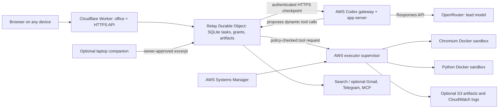

# Jarvis Meets Friday — demo, architecture and viva guide

Updated: 21 October 2026, IST. Read this guide before older design proposals. Deployment status and the trip result are recorded separately in DEMO_STATUS.md; a deployed URL alone does not prove a successful task.

## 1. Explain the project in 45 seconds

A cloud-hosted personal agent office. Jarvis takes an outcome, retrieves evidence, chooses tools, executes work and delivers files. The Codex app-server runs the lead agent loop on an AWS VM. Cloudflare serves the web app and persists tasks, permissions and artifacts. A separate sandbox executor runs Chromium and Python. Friday is an optional evidence checker, not a mandatory second full agent run. A laptop companion can release selected private excerpts after owner review; the core demo needs no laptop companion.

The contribution is integrating durable orchestration, isolated execution, controlled data disclosure and usable artifacts. It is a working systems prototype, not a claim of AGI, universal website access or proven superiority over commercial agents.

## 2. What runs where

- User device: browser UI only for the cloud demo. It does not execute the cloud agent. The optional Python companion is separate.
- Cloudflare Worker: HTTPS routing, static office UI, authenticated API entry point, security headers and bindings.
- Relay Durable Object: one owner-scoped SQLite state machine; tasks, messages, events, budgets, approvals, encrypted connection keys, delivery receipts and current SQLite artifacts. The class and migration remain Relay/v1.
- AWS EC2: existing t3.small, 2 vCPU / 2 GiB, ap-south-1. Actual attached disk: 25 GiB encrypted gp3 EBS.
- Codex container: pinned codex-cli 0.142.5, app-server JSON-RPC over stdio, one task-scoped session, GPT-5.4-mini through the configured OpenRouter Responses endpoint. Reasoning effort low. The image installs the system CA certificate bundle required by the native HTTPS client; Node HTTPS success alone does not prove native Codex HTTPS works. It is a real Codex runtime, not a renamed JSON loop.
- Executor supervisor: authenticates workspace requests; launches restricted Python/Chromium Docker containers and stores per-task scratch files.
- OpenRouter: paid inference; the Codex runtime is the harness, while GPT-5.4-mini is the lead model. Search uses the web plugin with Parallel Turbo and a separate compact synthesis call. Friday retains its separately configured API model.
- AWS S3: private deployment bundles and optional remote artifact storage. Current office report artifacts are SQLite-backed; do not claim every report is in S3.
- SSM: outbound managed-instance operations, installation and diagnostics. No SSH ingress is required.
- CloudWatch: configured bootstrap/executor log collection. Not every Codex event is a CloudWatch metric; application events are in task state.
- Cloudflare tunnels: outbound encrypted connectivity to loopback gateway/executor. Current quick-tunnel hostnames are temporary and change after restart.

## 3. Draw this architecture in the viva

Important distinction: the model proposes actions. The office policy gateway authorizes them. Giving an agent a VM does not give it the host shell, root access, AWS credentials or the Docker socket.

## 4. End-to-end task lifecycle

1. Owner submits a mission. The API persists task identity, original request, role/model snapshot and configured budget before work starts.
2. The Durable Object starts the task and contacts the task-scoped Codex gateway session.
3. Codex selects an office dynamic tool. The gateway pauses that call and returns its identity and arguments to the office.
4. The office validates arguments and permissions. Public sandbox autonomy can cover allowed code/browser work. Private disclosure and consequential external sends retain exact approval.
5. The actual tool executes. Its result is persisted and returned to the paused Codex process. Parallel independent reads can be batched; shared browser navigation and writes are not indiscriminately parallelized.
6. Codex observes evidence, revises the plan and continues. It must not invent a successful tool receipt.
7. artifact_create stores a real named HTML/PDF/CSV/etc. file. HTML preview appears in Result; Activity contains logs and sources. Drafts are labelled until review/finalization.
8. Completion/cancellation releases native sessions and sandbox processes. Storage can remain. A crashed native session is not silently re-executed: reconcile uncertain actions before a fresh task.

This is a hybrid architecture: native Codex reasoning/tool iteration plus a durable office scheduler and policy gateway. The office scheduler remains necessary for approvals, persistence and delivery control.

## 5. Roles and collaboration

Jarvis is the default lead. Automatic duplicate team review is off for the demo. Friday is available for a bounded fact/source/arithmetic check when requested or independently useful. Friday agreement is model opinion, not proof; source evidence matters. Jarvis owns the consolidated final answer.

Private files are not automatically copied to AWS. The companion scans only a selected folder with a local FTS index. A requested excerpt is reviewed locally and then sent to the configured provider. API inference is not private local inference. A knowledge graph and a local SLM are not implemented.

## 6. Cloud concepts actually implemented

- Serverless compute: the office API/UI routing runs on Workers; no dedicated UI web VM.
- Stateful cloud coordination: a Durable Object serializes owner state and persists task checkpoints in SQLite.
- IaaS: EC2 supplies the Linux execution host. It is separate from model inference.
- Containers: Docker isolates the native harness and per-task execution environments. Containers share the host kernel; they are lighter than another VM but are not an equivalent security boundary.
- Object storage: S3 holds private bundles and supports the optional remote artifact path. EBS stores the host/container volumes. SQLite currently stores office documents.
- Identity and access: app session cookies, encrypted saved keys, scoped role/tool grants, an instance profile for AWS operations, SSM management and exact outbound-send approvals.
- Network security: no inbound security-group rules on the demo VM; outbound tunnels; IMDSv2 required with hop limit 1; model-written code has no metadata access. Public browsing checks DNS and rejects private/metadata destinations.
- Observability: persisted task events and provider token receipts; systemd/container diagnostics; configured CloudWatch logs.
- Infrastructure as code: infra/aws-template.mjs generates the CloudFormation template. The existing named stack is separate from unrelated account workloads.
- Cost control: small instance, per-task optional budgets, native session cleanup and a fixed auto-stop timer. Stopped EC2 compute stops accruing instance runtime charges, while EBS/S3/logs can still cost credits.

Not implemented: Kubernetes, an autoscaling group, transparent failover, automatic load-driven VM scaling, Lambda task execution, or genuine idle-based wake/sleep. Never call the VM scale-to-zero serverless compute. AWS On-Demand describes billing; it does not automatically start/stop an idle VM.

## 7. Runtime configuration — explain each item

Worker bindings:
- ADMIN_PASSWORD: office login and encryption root. Never put it in slides, source or prompts.
- EXECUTOR_URL / EXECUTOR_SECRET: authenticated tool execution endpoint and shared bearer secret.
- CODEX_HARNESS_URL: authenticated cloud Codex gateway endpoint.
- Codex gateway token: stored in the office encrypted provider-key settings, or CODEX_HARNESS_TOKEN binding for a fresh deployment.
- ARTIFACT_STORAGE=sqlite: current report storage selection.
- ALLOW_DEMO=false: offline fixtures cannot masquerade as real inference.

Cloud harness environment:
- MODEL_BASE_URL=https://openrouter.ai/api/v1
- MODEL_API_KEY: server-only inference key; separate from gateway authentication.
- CODEX_MODELS=openai/gpt-5.4-mini: allowlisted model.
- HARNESS_STATE_DIR=/state: persistent Docker volume for native state and request receipts.
- HOST=0.0.0.0, PORT=8789 inside the container; host publication is loopback only.

Isolation: native built-in shell/filesystem/apps are disabled. Only registered office dynamic tools are allowed. The gateway container is non-root, read-only, capability-dropped and memory/CPU bounded. Python has network disabled; Chromium uses the controlled public-network proxy. No model-written container gets AWS keys or the Docker socket. The harness process does receive its model API key because it must invoke inference; distinguish this trusted harness from model-written code.

## 8. Demo operating procedure

Before presenting:
1. Confirm the cloud gateway and executor are healthy. Their health checks do not invoke a model.
2. Confirm Settings: Jarvis provider Codex, model openai/gpt-5.4-mini; Friday optional; automatic team review off. Confirm funded inference credits without exposing the key.
3. Open the office from the presentation device. Sign in, then open the successful real trip task from the board.
4. Show Result first: rendered HTML, native interactive disclosures, sources, assumptions, budget and download. Show full-size preview.
5. Show Activity only to explain actual tool evidence and task lifecycle. Show hover brief/current work/output for the agent.
6. Explain that estimates are not bookable flight/hotel offers. Missing dates/passengers/taxes/baggage require a real quote/reprice workflow.
7. Keep the existing completed artifact as a clearly labelled backup. A recording or stored result is not a new live inference run.
8. If doing a new live run, explicitly choose a bounded task budget. Avoid repeatedly clicking Retry after an uncertain send or native-session interruption.

Start/stop procedure: use the existing instance through SSM/AWS management; do not provision another VM. After a restart, start the two outbound tunnel services, read their current HTTPS URLs and update the Worker bindings. Redeploying without both URL overrides disconnects cloud execution/harness. Quick tunnels are a demo limitation; a stable authenticated named tunnel/domain is the production upgrade. Do not claim automatic wake when this manual step is required.

The normal two-hour boot timer is a runtime cap, not idle detection. For this presentation boot only, it is replaced by a one-time shutdown at noon IST on 21 October 2026, so the office can use the native harness during the assumed morning demo. Running EC2 continues consuming credits. After a later reboot the normal cap applies unless deliberately changed. Restart shortly before presenting and verify the timer; leave a clear owner-controlled shutdown plan. No auto-stop should kill an in-progress consequential action without reconciliation.

## 9. Why the earlier trip failed

The old DeepSeek route made two lead calls and a successful nested search: 3,014 + 2,998 + 4,617 = 10,629 reported tokens. These included repeatedly sent instructions, schemas and previous evidence; they were not all generated prose. A second search stopped at the 60-second deadline while consuming the response body. That body read was outside its error catch, so the task failed before artifact creation.

Fix: bounded response-body failures become safe, revisable search tool results; compact source notes and a smaller loop excerpt reduce repeated context; the complete research remains stored. Failure messages identify the last tool, and saved research is visible in the office. Codex is a new active runtime choice; changing a harness alone does not fix a broken tool adapter or guarantee a good itinerary.

## 10. Viva questions and short answers

Q: Why two clouds? A: Workers cheaply hosts the UI/control plane; EC2 supports the native Linux processes and browser/Python sandbox. Clear boundary rather than deploying everything on a VM.

Q: Why a Durable Object? A: Persisted coordination and owner-scoped serialized state, including approvals and recoverable task events. It is not an autonomous model.

Q: Is Codex the model? A: Here Codex app-server is the agent runtime. GPT-5.4-mini is the configured inference model through OpenRouter.

Q: What does Friday add? A: A separate bounded evidence check. It is optional because duplicate planning can waste latency/tokens.

Q: Why not Kubernetes? A: One small host and a few isolated jobs do not justify a cluster. Docker meets the current scope; orchestration can grow with measured load.

Q: Containers versus VMs? A: EC2 is the VM boundary. Docker provides lighter process/filesystem/resource isolation inside it, while sharing its kernel.

Q: Does stopping EC2 remove the files? A: No. EBS/container volumes remain until explicitly deleted. Storage/log/object charges may continue.

Q: What is elastic here? A: Serverless office request handling and configurable execution capacity. The current executor is one manually started On-Demand VM, not auto-elastic scaling.

Q: Where is Lambda? A: Not in the current execution path. Do not list it as implemented merely because an analogous event-driven concept exists.

Q: Where is S3 used? A: Private bundles and an optional remote artifact adapter. Current office HTML/PDF files use SQLite; EBS is the host disk.

Q: Can the agent do anything on my laptop? A: No. It has a constrained cloud tool catalog. Selected private files require the companion and disclosure review.

Q: Can all websites be accessed? A: Public domains are allowed by default, but private networks, metadata, CAPTCHA, authentication and site-specific limitations remain.

Q: Can it book/pay? A: Not in this demo. Search estimates cannot authorize a purchase or prove availability.

Q: How are credentials protected? A: Provider keys are server-side/encrypted in settings. The trusted harness has its inference key; model-written code never receives it. App OAuth is preferred over passwords in prompts.

Q: Is the result always factual? A: No. Source verification, dates and explicit uncertainty are essential; reviewer agreement alone is not evidence.

Q: How does parallel work happen? A: Independent read calls can batch with bounded concurrency. Shared browser navigation, workspace writes and external sends need ordered/conflict-controlled handling.

Q: Is memory a knowledge graph? A: No. Current memory uses saved notes/episodes and optional AgentMemory retrieval; the companion uses local FTS.

Q: What happens on a crash? A: Office task records persist. A native session interrupted mid-action requires reconciliation; transparent replay of uncertain actions is unsafe and not promised.

Q: How do you measure efficiency? A: Successful task completion, artifact validity, citations, latency, observed token usage, approvals and error recovery—not just number of agents or a flashy office.

Q: What remains for production? A: Stable tunnel/domain, automated scoped wake/idle leases, backups/restoration, session recovery coverage, live connector verification, streaming, stronger task benchmarks and explicit retention policy.

## 11. Team presentation division

- Person 1: problem, product flow and real HTML result.
- Person 2: Worker/Durable Object control plane and cloud concepts.
- Person 3: Codex harness, model/tool boundary and Friday's limited role.
- Person 4: EC2/Docker/security, cost controls, limitations and viva.

Show one real trace and artifact. Do not promise competitor parity, universal autonomy, a local SLM, a graph database or production autoscaling.

## 12. Primary technical references

- Codex app-server: https://developers.openai.com/codex/app-server
- OpenRouter Responses API: https://openrouter.ai/docs/api_reference/responses/overview
- Cloudflare Durable Objects: https://developers.cloudflare.com/durable-objects/
- EC2 instance lifecycle: https://docs.aws.amazon.com/AWSEC2/latest/UserGuide/ec2-instance-lifecycle.html
- AWS Systems Manager: https://docs.aws.amazon.com/systems-manager/latest/userguide/what-is-systems-manager.html
- Actual implementation: src/index.ts, src/codex.ts, harness/, executor/, infra/.
