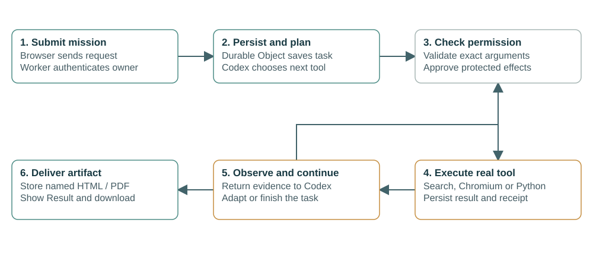
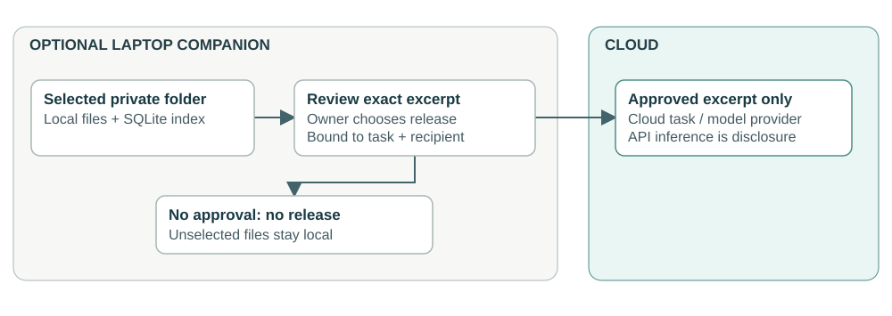
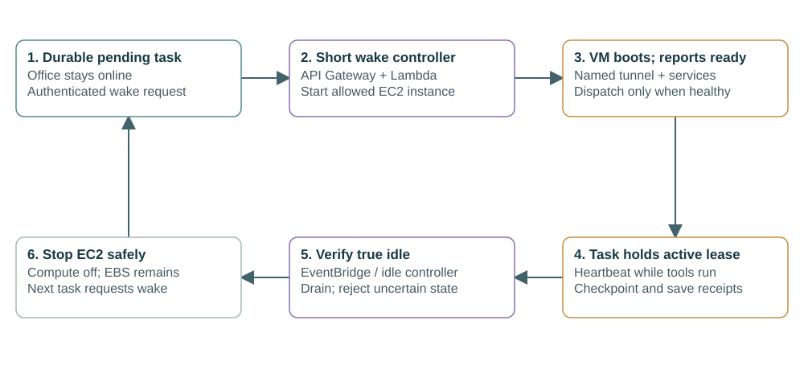

# Jarvis Meets Friday: how the cloud system works

Architecture, operation and presentation guide · 21 October 2026

## 1. Explain the project first

Jarvis Meets Friday is a cloud-hosted assistant office. You give Jarvis an outcome, such as researching a trip and producing an HTML report. Jarvis chooses tools, gathers evidence, executes permitted actions and delivers a file. Friday is a second, optional agent for focused evidence checks.

**The website, agent runtime and execution tools run in the cloud. Your presentation laptop only opens the website.** Closing your browser does not move execution onto your laptop. A separate, optional laptop companion exists for selected private files; the cloud demonstration does not need it.

The project combines two cloud providers with an external model API: Cloudflare hosts the web application and persistent coordination; AWS hosts native agent execution and sandbox tools; OpenRouter routes inference requests to the selected model providers. We are not training or serving an LLM on the AWS VM.

A useful presentation sentence: “We built an autonomous tool-using assistant with persistent cloud task state, isolated execution, controlled data access and inspectable outputs.” The office characters are the interface; the cloud services behind them are the computing project.

## 2. The complete deployment picture

Read the arrows as network requests. A box inside the AWS boundary runs on AWS; a model provider outside it is reached through an API. Jarvis and Friday are software roles, not two physical computers.

| Location | What runs there | What it does |
| --- | --- | --- |
| Any user device | Web browser | Shows the office, sends requests, displays results and approvals. No local model or Docker installation needed. |
| Cloudflare | Worker and static assets | Hosts HTML/CSS/JavaScript, HTTPS endpoints, session authentication and API routing. |
| Cloudflare | Relay Durable Object with SQLite | Stores missions, messages, permissions, tool receipts, settings, memory notes and current artifact files. Coordinates task progress. |
| AWS, Mumbai region | One EC2 Linux VM | Hosts the native Codex gateway, Docker supervisor and isolated execution containers. |
| External inference providers | Models accessed through OpenRouter | Generate decisions, tool calls and text. Model computation happens at the provider, not on our VM. |
| Optional selected laptop | Python companion and SQLite file index | Searches selected private folders and releases only approved excerpts. It does not create a laptop VM. |

## 3. Technologies and why each is here

| Technology | Role in this implementation |
| --- | --- |
| HTML, CSS, JavaScript | Office interface, result previews, settings and the cloud console; no React or Next.js runtime. |
| TypeScript | Worker API, task coordinator, provider adapters, tools and permissions. |
| Cloudflare Workers | Serverless application hosting and HTTP request handling. |
| Durable Objects + SQLite | Persistent owner-scoped coordination and storage. This is not D1, Redis or an in-memory queue. |
| Codex CLI 0.142.5 app-server | Native lead-agent harness, running in a cloud Docker container. Uses JSON-RPC over standard input/output internally. |
| OpenRouter Responses API | Connects the cloud Codex process to Jarvis's configured model. |
| OpenRouter chat/tool API | Runs Friday and supported direct-provider paths. OpenRouter also supplies Parallel Turbo web search. |
| GPT-6 Luna / DeepSeek V4 Flash | Current configured Jarvis and Friday models respectively. Configuration and catalog access are verified; no new paid benchmark was run after switching. |
| Amazon EC2 + Amazon Linux | Linux VM needed for native processes and Docker execution. Current size: t3.small, 2 vCPU, approximately 2 GiB RAM. |
| Docker | Separates the trusted Codex process from model-written Python and browser execution. CPU, RAM, process and filesystem limits bound jobs. |
| Node.js 22, Playwright, Chromium | Trusted executor and programmatic browser tools. Models can inspect real page controls before acting. |
| Python 3 | Sandboxed calculations/code and the optional laptop companion. |
| pdf-lib | Creates supported PDF artifacts in the application. HTML content is authored by the agent and stored by the artifact tool. |
| EBS gp3 | Encrypted persistent VM disk and Docker workspace volumes; current disk is 25 GiB. |
| Amazon S3 | Private deployment bundles and an optional remote artifact-storage path. Current office reports are stored in SQLite. |
| IAM, SSM, Parameter Store | Scoped host permissions, management without SSH ingress and protected executor-secret setup. |
| Cloudflare Tunnel | Outbound connection from the AWS host to HTTPS endpoints; application ports stay on loopback. |
| CloudWatch + application events | Host/bootstrap log configuration and persistent task events. The app console is not an AWS billing dashboard. |
| AgentMemory, optional | Separate authenticated memory service. Built-in notes remain available without it; the optional service uses keyless retrieval. |
| MCP, Gmail, Telegram | Tool and communication integrations with separate configuration and access checks. Connection code does not prove a working external account. |
| Wrangler, CloudFormation, GitHub Actions | Worker deployment, AWS infrastructure definition and automated checks. Miniflare supplies local Worker integration tests. |

LangChain, LangGraph, AutoGen, Kubernetes, Kitesurf and a knowledge graph are not part of the current execution path. They are not required to explain this implementation. Cloudflare Durable Objects are used directly; we are not claiming the Cloudflare Agents SDK runs the lead reasoning loop.

## 4. What Codex, Jarvis and Friday actually mean

**The model** predicts useful text and tool calls. **The harness** runs the observe/act loop and manages its process/session. **The coordinator** persists work, checks permissions and routes real tools. These are different responsibilities.

Jarvis uses native cloud Codex as its harness. It is not the Codex desktop app on your presentation laptop and does not borrow a ChatGPT subscription. The harness calls the configured API model using a server-held inference key.

Codex's unrestricted native host tools are disabled in this integration. It receives registered office tools instead. A browser call goes through our executor; a file artifact goes through our storage adapter; email goes through our approved messaging path. This keeps durable permissions and receipts in one place.

Friday uses its separate model API as an evidence steward. It can check a source packet, arithmetic or a contradiction and return a concise finding. Automatic duplicate review is off: making two agents repeat every task increases cost without proving better output. Jarvis owns the final consolidated result.

A meaningful collaboration example: Jarvis drafts a comparison; Friday checks three consequential claims against named sources and flags one unsupported price; Jarvis corrects the report and labels the estimate. “Friday agrees” alone is not evidence. A benchmark proving the pair beats Jarvis alone remains future work.

## 5. Follow one real task from start to finish

1. You submit a mission. The Worker authenticates the session and passes it to the Durable Object.
2. The coordinator saves the original request, task ID, selected model and budgets before execution starts. Browser refresh does not delete that record.
3. The coordinator calls the task-scoped cloud Codex session. Codex proposes an office tool operation with arguments.
4. The policy layer validates the operation. Public sandbox work can run autonomously; private disclosure and consequential messages retain exact approval.
5. The real tool runs. Search retrieves public evidence; Chromium inspects websites; Python executes code; each result returns with its tool-call identity.
6. The coordinator saves the result and returns it to Codex. Codex observes what happened, revises its next action and continues. Independent reads can batch; shared browser navigation and conflicting writes need ordering.
7. For a requested report, `artifact_create` stores a named file and returns its receipt. An HTML preview opens in the app's Result view. A workspace file or a pasted code block alone is not a delivered artifact.
8. The final answer links the output and states important gaps. Activity contains the trace; Result contains what the user should read. Sessions and execution processes are cleaned up when work finishes or is cancelled.

Current evidence: a real December Mumbai trip report completed through cloud Codex after earlier failures were repaired. Its continuation reused the earlier research. It was not a flawless single run; fares are estimates, not live bookable offers. The model switch has not been re-benchmarked with a paid task.

## 6. Data, memory and private files

Cloud uploads and laptop indexing are different actions. Uploading a document in the web app sends it to cloud storage. Selecting a folder in the companion builds a local SQLite search index; it does not automatically upload that folder.

For local evidence, the cloud agent requests information. The companion finds candidate excerpts. The owner reviews the exact release and intended recipient. Only approved content is sent onward. A local request can still disclose text to an external model API: API inference is not on-device inference.

The model may request data, but deterministic policy decides whether the release is authorized. This is the implemented meaning of “data negotiation”; it is not an autonomous model bargaining away privacy restrictions. Current memory is notes, episodes and retrieval, not a knowledge graph or a locally hosted SLM.

| Data | Current home | Lifetime or limitation |
| --- | --- | --- |
| Tasks, approvals, results, settings | Durable Object SQLite | Persist across browser refresh and Worker requests. Historical content needs an explicit retention policy. |
| Provider/connector keys saved in settings | Encrypted server-side records | Never intentionally returned to the browser or model-written code. Password-derived encryption needs future hardening. |
| Browser/Python scratch files, native session receipts | AWS EBS / Docker volumes | Survive stopping the EBS-backed VM; interrupted native processes need reconciliation, not blind replay. |
| Final office HTML/PDF artifacts | SQLite in the active configuration | Downloadable even when AWS execution is stopped. S3 is an optional adapter, not the current default. |
| Private companion document index | Selected laptop | Requires pairing and approved excerpt release. Not needed for the cloud-only demonstration. |

## 7. How AWS and networking are configured

The infrastructure template creates a dedicated VM, security group, instance profile, private encrypted/versioned S3 bucket and log group. It uses an existing VPC/subnet. A public IPv4 address provides outbound internet access; the security group has no inbound rules, so that address does not expose SSH or the agent API.

The trusted Linux supervisor launches Docker sandboxes. Python has network disabled. Chromium uses a public-only proxy with address checks; private networks and instance metadata are blocked. The trusted Codex container needs its model API key, while model-written code receives neither that key nor AWS instance credentials.

SSM manages the host using its instance profile. Cloudflare Tunnel runs an outbound connection to Cloudflare and forwards authorized requests to loopback services. There is no need to open application ports to the internet. IMDSv2 and hop-limit restrictions help keep host metadata out of untrusted containers.

Current tunnel endpoints are temporary quick tunnels. Their hostnames can change on restart, requiring updated Worker bindings. This is the main reason the existing setup is not yet “configure once.” A persistent named tunnel with stable hostnames is the recommended prerequisite for automated wake/sleep.

## 8. Configuration: what is set once, and what changes

| Configuration | Where configured | Meaning |
| --- | --- | --- |
| `RELAY`, class `Relay`, migration `v1` | Wrangler | Existing durable-state binding. Renaming/replaying migration can break stored data. |
| `ADMIN_PASSWORD` | Worker secret | Office authentication and current encryption root. Never put it in slides. |
| `EXECUTOR_URL`, `EXECUTOR_SECRET` | Worker deployment | Address and bearer credential for cloud tools. |
| `CODEX_HARNESS_URL`, gateway token | Worker settings/secret | Address and authentication for the cloud Codex service. This token is not the model key. |
| `MODEL_BASE_URL`, `MODEL_API_KEY` | Trusted AWS harness environment | Inference provider endpoint and key. |
| `CODEX_MODELS` | AWS harness environment | Allowed model IDs; includes the requested GPT-6 Luna. |
| Jarvis/Friday models, review, budgets | App Settings | Role routing and task preferences. Existing tasks retain their captured configuration. |
| `ARTIFACT_STORAGE=sqlite`, `ALLOW_DEMO=false` | Worker variables | Active report storage; prevents canned demonstration tasks masquerading as real inference. |
| Google OAuth client/secret/callback | Google Cloud and app Settings | Gmail authorization; separate from Gemini inference credentials. |
| Telegram bot and owner pairing | BotFather and app Settings | Private communication channel, not a shared public bot inbox. |
| MCP URL, credential, role/tool grants | App Settings | Which discovered remote tools each role can access. |
| VM timers, instance size, disk, IAM | AWS template / host management | Runtime, resource and cost controls. |

Deployment means building the Worker/static assets, deploying them with both current cloud endpoint bindings, updating the Linux runtime when needed, then checking authenticated health. A plain Worker deploy with blank endpoint defaults disconnects execution. Store deployment-specific values outside public source control.

## 9. Elastic AWS design: recommended next step

**Current behavior:** one VM is started for the demonstration and stopped by a fixed timer. EC2 On-Demand describes its purchasing/billing mode; it does not automatically sleep when idle. Current deployment is not an Auto Scaling group.

**Proposed configuration, for discussion:** keep the serverless office online, and give the existing executor VM demand-driven start/stop with task leases. Start with capacity zero or one; do not add a cluster before measuring concurrency demand.

1. The Durable Object persists a pending mission and requests a signed wake operation from a small AWS control endpoint.
2. API Gateway authenticates that machine request; a short Lambda checks the one allowed instance and requests StartInstances only when necessary. Start capability is scoped to this project, never a general AWS command tool for the model.
3. The VM boots its configured services and persistent named tunnel. A readiness check must pass before the coordinator sends work. The UI says “Starting cloud executor” while waiting.
4. Each running task holds a lease and refreshes its heartbeat. Waiting for owner approval should checkpoint and release compute where safe; it must not keep a browser VM alive indefinitely without an explicit timeout.
5. An EventBridge-triggered idle check asks whether leases/work are active. After an idle grace period, drain safely, persist receipts, and call StopInstances. Unknown health or uncertain side effects must not be treated as safe idle.

Configure the instance ID, narrowly scoped IAM role, machine authentication, stable tunnel, idle timeout, readiness timeout and demo override once. Keep an emergency runtime ceiling, but distinguish it from the normal idle policy. Do not attach the student's personal login session to the running application.

This proposal adds real event-driven/serverless control without moving a long-lived Codex session into a Lambda invocation. The trade-off is startup delay after idle. EBS, S3 and logs can still cost money while EC2 is stopped; stopping is not deletion.

For a later multi-user fleet, use a queue, task-aware routing and an EC2 Auto Scaling group or an appropriate container service. Workers need portable state and scale-in protection; multiplying VMs without redesigning current single-host browser/session assumptions will not produce safe horizontal scaling. The console's scaling lab is a simulation only.

No new scaling infrastructure is being provisioned during this design discussion.

## 10. What the cloud console proves

The PR console combines deployment overview, architecture mapping, security posture and a clearly labelled scaling lab. Live runtime health includes the AWS executor and authenticated Codex model catalog. Host telemetry now reports CPU count, one-minute load, memory and active tool operations. Load average is not CPU-utilization percentage; memory includes OS/cache.

Task totals and token counts include historical setup failures. A health check proves reachability, not that a model can finish every task. Configured connectors are not automatically working accounts. The JSON export omits artifact bytes and credentials and has no restore workflow, so it is a partial export, not a complete disaster-recovery backup.

A useful demonstration: open a completed real report, inspect its evidence under Activity, then open Cloud console to show which services handled it. Use the scaling lab to explain a future policy, explicitly saying that it creates no actual AWS servers.

## 11. Features, readiness and honest gaps

| Capability | Status for the demonstration |
| --- | --- |
| Hosted office, persisted missions, Result/Activity and HTML preview | Implemented and deployed. |
| Native cloud Codex, browser/Python executor | Deployed; real earlier report completed. |
| Requested models | GPT-6 Luna and DeepSeek V4 Flash configured; new-model task quality not paid-tested. |
| Runtime health and AWS CPU/RAM telemetry | Live checks succeeded. |
| Friday delegation/review | Implemented, optional; no controlled quality-per-token improvement established. |
| Gmail | Saved malformed client rejected; valid Web application OAuth client and owner consent still required. |
| Telegram, MCP and companion | Configuration/capabilities exist; demonstrate only integrations actually paired and verified. |
| Automatic wake/idle shutdown and stable tunnel | Proposed above, not yet implemented. |
| Efficient context, hard billing limit, crash recovery and complete backups | Remaining engineering work. App guards cannot cancel already billed in-flight tokens. |

## 12. Viva answers and presentation order

**Q: Why is this cloud computing rather than a chatbot wrapper?** A: External models supply inference, but our system persists distributed tasks, controls access, operates remote isolated execution, stores artifacts and manages failure/monitoring across providers. A model API alone would not supply those system responsibilities.

**Q: Where is the AI running?** A: The agent harness runs on AWS; model inference runs at the API provider; coordination and storage run on Cloudflare. The user's browser displays the interface.

**Q: What is serverless here?** A: Worker request handling and managed durable state. The existing AWS VM is not serverless; the proposed wake controller would use Lambda.

**Q: Why containers inside a VM?** A: EC2 supplies the operating-system machine boundary; Docker gives lighter execution isolation and resource controls within it. Containers share the host kernel.

**Q: Why not Kubernetes?** A: One small host and a few sandbox jobs do not justify operating a cluster. It can be revisited when measured workload requires it.

**Q: Is JSON evidence of a weak harness?** A: No. JSON is the transport format for tool calls/checkpoints. The live lead harness is native Codex; reliability still depends on our adapters, budgets and tool results.

**Q: Does data stay private because Friday runs locally?** A: Friday's configured inference is currently an external API. Only the optional companion index is local. Approved text sent to any provider is disclosed to that provider.

**Q: What survives a failure?** A: Persisted task records and artifacts survive browser loss. EBS survives normal stop/start. A lost native process is not transparently resumed; uncertain actions need reconciliation.

**Q: What is genuinely elastic today?** A: The managed serverless app handles requests without a dedicated web VM. Demand-driven AWS executor scaling is the proposed improvement, not a completed feature.

**Q: What did you actually verify?** A: A real earlier Codex report, live service/resource health, stored artifacts, and code/integration checks. New model quality and unpaired external account actions are not claimed.

Presentation order: explain the user problem; show the real report; draw the deployment diagram; walk one tool call through the task diagram; demonstrate Cloud console; explain privacy and the proposed elastic lifecycle; finish with limitations and next work.

## 13. Source map and primary references

Project sources: `src/index.ts` (coordination/API), `src/codex.ts` and `harness/` (native runtime bridge), `executor/` (tools), `src/cloud.ts` and `src/cloud-status.ts` (console/probes), `src/messaging.ts` (OAuth/delivery), `companion/` (private files), `infra/` (AWS setup), `wrangler.jsonc` (Worker bindings), `.github/workflows/checks.yml` (CI).

- https://docs.aws.amazon.com/AWSEC2/latest/UserGuide/Stop_Start.html — stop/start persistence and addressing.
- https://docs.aws.amazon.com/autoscaling/ec2/userguide/as-using-sqs-queue.html — queue-aware fleet scaling.
- https://docs.aws.amazon.com/lambda/latest/dg/gettingstarted-limits.html — invocation constraints; short controller versus long-running runtime.
- https://developers.cloudflare.com/cloudflare-one/networks/connectors/cloudflare-tunnel/ — outbound tunnel architecture.
- https://developers.cloudflare.com/durable-objects/ — managed stateful coordination.
- https://developers.openai.com/codex/app-server — native Codex protocol.
- https://developers.google.com/identity/protocols/oauth2/web-server — Gmail OAuth setup.
