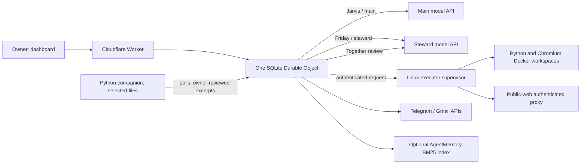

# Architecture and direction

This document separates the running prototype from a possible next architecture. The roadmap is contextual: sequence and components should change when evaluation, deployment constraints, or owner priorities change.

## Current implementation

The dashboard and Cloudflare Worker address one SQLite Durable Object that owns task state, approvals, chat, schedules, memory records, and delivery receipts. Durable Object alarms advance one turn at a time. Tasks select Jarvis (main provider), Friday (steward provider), or Together (main provider with optional Friday review). Both models are API calls. Friday's model is not running on the laptop.

Jarvis has the general cloud tool set. Friday's cloud tool list is limited to approved-memory search/read, a request to the paired companion, and artifact creation. The companion is a separate standard-library Python/Tkinter program. It scans only the owner-selected folder and asks the owner to review and release the exact excerpt. The excerpt then goes to the Worker and configured model API; this is explicit disclosure review, not local inference. The app has no local model, knowledge graph, MCP runtime, or parallel tool-call batching.

The task alarm loop executes model calls and tool calls serially, one call per alarm turn. That simplifies recovery and approval ordering but does not parallelize independent reads. A worker turn can continue after a browser or tool request; generated code does not run inside the Worker. Python runs in a separate Docker container without network. Browser tasks use Chromium and a task-scoped authenticated proxy when the domain policy is `*`. Public destinations are DNS-pinned to public IPv4 addresses; private/reserved and metadata destinations are rejected. Exact-domain policies remain available. Containers share their host kernel.

Durable Object memory is authoritative. Optional AgentMemory runs separately and performs keyless BM25 retrieval. The Worker stores source IDs and resolves index hits back to current Durable Object rows; it does not treat indexed text as authority. Embeddings, graph extraction, and consolidation are disabled. The laptop companion does not hold a corpus-wide knowledge graph or vector index.

Cloudflare production deployment and live provider inference are not verified. A dedicated AWS VM previously passed Docker/Python/browser/S3 checks, but it was stopped at the last check. No current end-to-end Worker-to-running-VM path is claimed. Local component and stub-backed integration checks establish only the paths they exercise.

## Two-role collaboration model

Today, role names are routing and tool-policy choices inside one application, not two independently deployed agent services. Jarvis and Friday have separate provider/model settings but share the same Durable Object, task record, and approval mechanism. Together starts with Jarvis; when that response is ready, the task may request approval for Friday to review the draft and supplied evidence, then continue with Jarvis. Review is an opinion, not proof. Shared task chat records owner, operator, and steward messages; it does not imply independent agents are always concurrently reasoning.

Future Friday should act as a privacy-preserving evidence steward. Keep private source documents on the user's device by default. Jarvis should state a concrete question and purpose; Friday should show the requested scope, select relevant local sources, and negotiate a narrow grant with the owner. Friday returns only approved evidence snippets or aggregates with source identity, location, timestamp/version, extraction method, and relevant uncertainty. Jarvis can cite these source IDs in its answer; Friday can challenge an unsupported claim by pointing back to approved evidence. The owner can deny, narrow, expire, or revoke a grant. Denial must leave the underlying files on device and must not silently retry through a cloud index.

This is a proposed protocol, not current behavior. The existing local request flow is a single selected-folder operation with an exact release review. It does not yet ingest PDFs and office documents into a provenance-rich local index, negotiate reusable scoped grants, or support source-backed corrections across several files.

A concrete future exchange is: (1) Jarvis sends Friday a question, purpose, and narrow requested data scope; (2) Friday reports the local capability and candidate source metadata without uploading document contents; (3) the owner grants, narrows, denies, expires, or revokes that task-bound scope; (4) deterministic local policy checks the grant and source versions; (5) Friday may use a small model locally or through an explicitly approved provider to redact and select evidence; (6) only the approved subset and provenance cross to Jarvis; (7) Jarvis answers with source references; (8) Friday checks claims against the released evidence, then stores only an episode allowed by the same grant. The small model and model-provided tool annotations never decide authorization.

Treat these as different disclosure paths. If a dashboard file-upload path is added, uploading sends the file to the Worker as soon as transfer begins; label it as cloud disclosure and apply server-side retention/deletion policy. It is not a private local-retrieval path. Private retrieval should start from a local file picker in the companion. A local ingest proposal covers PDF, DOCX, and text first, with bounded file size/page count, archive-bomb checks, parsers isolated from the UI process, optional OCR with separate consent, chunk IDs and content hashes, source path/name, page or paragraph location, parser/OCR version, source modification time, and a stable ingestion timestamp. Keep the parsed corpus and indexes local. Stage only owner-approved chunks to the cloud with task/grant ID and short TTL; delete staged material on expiry, revoke, task completion where possible, and explicit forget. Record deletion failures and provide a cleanup job. This ingestion and staging design is not implemented.

The office UI should remain a whole-screen pixel/cartoon/LEGO-like workplace, rather than becoming a conventional chat page. Keep the two-room world and current character/desk frame as the visual anchor. Put task composition and Settings in panels/dialogs rendered over the world, so they feel like room surfaces and can close back to the same scene and selection. Clicking a character opens their task queue; hover may preview recent transcript/state, while keyboard focus/click provides the same content for touch, keyboard, and screen-reader use. On narrow/mobile screens, use tappable agent cards or a room switcher with adequate targets and no hover-only controls. Every sprite/state change must be driven by real backend status (queued, running, waiting for approval/local input, complete, failed, offline); show timestamps and stale/offline status. Do not animate fake work or synthetic transcripts as live agent activity. Respect reduced-motion and provide text labels and accessible names for decorative characters/controls. The existing interface already has the office-room frame, desks, sprites, task assignment, and Settings dialog; these are refinements and state-integrity requirements, not a claim that the full proposed interaction design is finished.

## Proposed MCP integration

MCP is a future connector boundary, not present in this codebase. For remote servers, use the official [Streamable HTTP transport](https://modelcontextprotocol.io/specification/2025-11-25/basic/transports): initialize and negotiate protocol version/capabilities; maintain the negotiated session ID and protocol-version headers; handle paginated `tools/list` and `resources/list`; list schemas when a connector is selected and lazily load only the relevant tool schemas for that role/task. Detect expired sessions (including HTTP 404) and reinitialize; revoke the connector session and OAuth grant on disconnect. Apply origin validation and authentication at the remote server boundary.

Do not trust tool/resource descriptions or MCP annotations as policy. Treat them as untrusted metadata for presentation. The Worker must enforce connector identity, role allowlist, owner grant, argument validation, approval, and output limits independently. Keep OAuth client secrets and refresh tokens encrypted server-side; issue least-privilege, short-lived access and session credentials where supported. Friday and Jarvis receive separate connector grants. A Friday grant may expose local resources only to Friday until an explicit owner-approved excerpt is returned to Jarvis. A Jarvis grant must not widen Friday's local scope.

For local MCP servers, use a companion-owned stdio subprocess bridge on the laptop. For cloud-host tools, use a separate allowlisted stdio bridge on the executor VM, outside task containers. The bridge owns executable paths, environment, working directory, lifecycle, and protocol framing; models must never pass arbitrary executable/command lines. Issue per-server, per-role, per-purpose grants with a clear data-flow preview. Local stdio access should default to no server and no resources until the owner opts in. The protocol's distinction between stdio and Streamable HTTP transports, session lifecycle, and security requirements is described in the [MCP transport specification](https://modelcontextprotocol.io/specification/2025-11-25/basic/transports).

## Proposed execution design

### Proposed runtime placement

Keep one cloud coordinator as the durable source of task truth; it owns task IDs, checkpoints, grants, leases and delivery receipts. Evolve Friday's laptop companion into a lightweight resumable service with a local SQLite vault/index, selected-folder access and an outbound authenticated channel. It can run natively without Docker or a hypervisor. A container is optional packaging; it does not grant safer access to the whole laptop. No always-on GPU or local model is required. With API-only inference, deterministic search and policy run locally, and the owner approves the exact inputs sent to an SLM provider. A genuinely offline Friday model is a later interchangeable inference adapter.

Keep the Linux VM as a separate execution boundary for Jarvis's browser/code tasks, not the private corpus owner. The host supervisor manages isolated task containers and cloud artifact credentials. Cloud-approved shared memory can remain in the coordinator; private retrieval memory remains local. AgentMemory hosting is a deployment choice, not permission to mirror the private vault to a cloud index. If the laptop is asleep or disconnected, Jarvis can continue public work and mark private-dependent nodes blocked; never invent Friday's reply.

This preserves platform-native durability without introducing two cloud VMs merely to give each character a machine. Reconsider LangGraph or the Cloudflare Agents SDK when branching/checkpointing/MCP needs clearly exceed this state machine. A framework migration must demonstrate recovery and token/latency benefit against the same fixtures; framework choice alone does not supply those properties.

### Recovery and concurrency

For an independent read batch, persist each operation ID, dependency, input hash, authorization snapshot and pending state before dispatch. Use a bounded worker pool and collect successes and failures independently; persist results by operation ID rather than completion order. Resume only unfinished safe reads after restart. Check cancellation and grant validity both before execution and before releasing results. Apply provider-rate-limit backoff and queue pressure rather than launching unbounded promises.

Lock mutable browser sessions, workspace paths and message destinations at the narrow resource boundary. Release leases after completion/cancellation and recover expired leases. Keep one authoritative task-state writer; asynchronous operations must not overwrite a newer task revision. Reads against a changing source must record its version. A timed-out send stays uncertain until reconciled; a reviewer does not make a repeat send safe. These are proposed invariants to test, not implemented batching behavior.

If evaluation shows serial tool turns are the bottleneck, evolve toward a bounded task DAG. Keep one durable owner for checkpoints and approvals. Independent, read-only retrieval tasks may run concurrently within explicit per-task limits; writes, browser clicks/fills, sends, and other side effects remain serialized behind exact approval. Preserve task cancellation, idempotency keys, timeouts, result ordering, and restart recovery. Parallelism must not weaken destination policy or approval checks.

Budget policy should be explicit in Settings and task records: per-task step/token caps, provider call accounting, concurrency limits, and optional wall-clock limits. Do not send the whole conversation or corpus on every turn: maintain a stable system prompt, retrieve only bounded top-k evidence, batch related bounded retrieval queries where safe, and summarize older task context with source references. Reuse stable prompt prefixes where the provider supports prompt caching; measure token deltas and avoid caching private content across grants or source versions. Add result caching only with sensitivity-aware keys, content/version hashes, freshness and expiry rules, invalidation on edits/revokes, and a clear disable switch. Small-model routing is a measured option for classification, extraction, or critique; it does not make authorization decisions. The current null step/token defaults mean the app imposes no such cap until the owner configures one. Token checks happen between calls and a call can overshoot.

## Evaluation before expansion

Do not claim parity with commercial assistants from feature lists or architecture diagrams. Build a versioned task suite that measures task success, evidence correctness, privacy leakage, approval compliance, latency, token/cost use, recovery after restart, and duplicate side effects. Compare at least: Jarvis alone; Jarvis plus Friday retrieval without critique; and the two-role flow with review. Report failures and uncertainty by task class. Add graph retrieval, local inference, MCP, DAG parallelism, or caching only where ablations show a useful gain at acceptable privacy and cost.

See [remaining work and decision gates](REMAINING_WORK.md), [memory setup](office-memory.md), [messaging setup](messaging.md), and [runtime decision record](decisions/002-agent-runtime.md).
