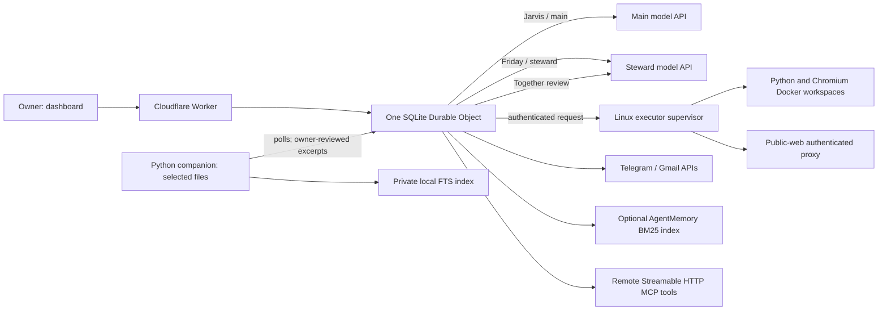

# Architecture and direction

Current 21 October deployment: Jarvis is routed through the AWS-hosted Codex app-server and GPT-5.4-mini; Friday is optional. The Durable Object remains the persistence/permission control plane. Read DEMO_VIVA_GUIDE.md and DEMO_STATUS.md for the current verified configuration; older alternatives below are historical context.

This document separates the running prototype from a possible next architecture. The roadmap is contextual: sequence and components should change when evaluation, deployment constraints, or owner priorities change.

## Cloud harness option - 16 October 2026

The optional `codex` provider routes reasoning to native Codex app-server in a separate cloud Linux container. The Worker retains task authority, grants and tools; the laptop retains selected private documents. Each task has its own cloud process/thread. This is implemented but not deployed/live-model verified. Existing direct Gemini/OpenRouter roles remain available and saved settings are unchanged. See [cloud harness deployment, protocol and recovery limits](CLOUD_CODEX.md).

## Current implementation

The dashboard and Cloudflare Worker address one SQLite Durable Object that owns task state, approvals, chat, schedules, memory records, and delivery receipts. Durable Object alarms advance tasks, with up to two active turns and bounded independent read batches. Tasks select Jarvis (main provider), Friday (steward provider), or Together (main provider with optional Friday review). Both models are API calls. Friday's model is not running on the laptop.

Jarvis has the general cloud tool set. Friday's tools include approved-memory search/read, requests to the paired companion, artifact creation, teammate delegation, and explicitly role-granted MCP tools. The companion is a separate Python/Tkinter program with a private local FTS index. It scans only the owner-selected folder and asks the owner to review and release the exact excerpt. The excerpt then goes to the Worker and configured model API; this is explicit disclosure review, not local inference. Friday is a separately configured API-model role in the Worker, not a local reasoning model. The laptop companion uses deterministic local indexing, not a model or knowledge graph. Remote Streamable HTTP MCP tool connectors are implemented with manual role/tool grants and owner-attested read-only exceptions; OAuth MCP, resource browsing, and stdio bridges are not implemented. Independent reads can run in bounded batches.

The Durable Object starts up to two task turns at once. Within a task, Settings controls a bounded batch of independent `web_read`, `workspace_read`, `workspace_list`, and `task_history` calls (default 3, range 1–8); writes and approval-required actions remain serialized. Context is compacted to the configured character budget (default 60,000; range 20,000–180,000), and task detail can report active characters and omitted history groups. Task step/token budgets remain unset until configured. `sandboxAutonomy` can allow sandbox code, file, and browser actions only on tasks without private context; messages, external writes, and local disclosure still require review. A worker turn can continue after a browser or tool request; generated code does not run inside the Worker. Python runs in a separate Docker container without network. Browser tasks use Chromium and a task-scoped authenticated proxy when the domain policy is `*`. Public destinations are DNS-pinned to public IPv4 addresses; private/reserved and metadata destinations are rejected. Exact-domain policies remain available. Containers share their host kernel.

Durable Object memory is authoritative. Optional AgentMemory runs separately and performs keyless BM25 retrieval. The Worker stores source IDs and resolves index hits back to current Durable Object rows; it does not treat indexed text as authority. Embeddings, graph extraction, and consolidation are disabled. The laptop companion does not hold a corpus-wide knowledge graph or vector index.

Task-family budgets are shared across delegated Jarvis/Friday work, with cancellation propagated to child tasks; delegation and waiting are agent-chosen tool actions, not a fixed workflow. The Worker can run two task turns concurrently. Production deployment and a live cloud-to-executor path are not verified. Owner-configured runs through Jarvis and Friday produced downloadable artifacts whose contents were checked. Delegated teammate work completed and returned its child result; the combined team final artifact was checked after an owner-denied VM write and development-restart recovery; this was not an uninterrupted autonomy benchmark. Free APIs are quota/rate limited; the Worker backs off and retries temporary model rate limits up to three times, then surfaces failure. This smoke test does not establish broad task quality or parity. A dedicated AWS VM previously passed Docker/Python/browser/S3 checks, but it was stopped at the last check. No current end-to-end Worker-to-running-VM path is claimed. Local component and stub-backed integration checks establish only the paths they exercise.

## Two-role collaboration model

Today, role names are routing and tool-policy choices inside one application, not two independently deployed agent services. Jarvis and Friday have separate provider/model settings but share the same Durable Object, task record, and approval mechanism. Together starts with Jarvis, with optional owner-configured Friday review; either role can also autonomously delegate focused work to its teammate, wait, and retrieve the result. Delegated tasks share the root task's configured step/token budget and cancellation. Review is an opinion, not proof. Shared task chat records owner, operator, and steward messages. The scheduler can advance two task turns concurrently; it does not guarantee every task uses both roles.

Future Friday should act as a privacy-preserving evidence steward. Keep private source documents on the user's device by default. Jarvis should state a concrete question and purpose; Friday should show the requested scope, select relevant local sources, and negotiate a narrow grant with the owner. Friday returns only approved evidence snippets or aggregates with source identity, location, timestamp/version, extraction method, and relevant uncertainty. Jarvis can cite these source IDs in its answer; Friday can challenge an unsupported claim by pointing back to approved evidence. The owner can deny, narrow, expire, or revoke a grant. Denial must leave the underlying files on device and must not silently retry through a cloud index.

This is a proposed protocol, not current behavior. The companion now builds a private local FTS index over supported text and office/PDF documents, retains source provenance locally, and supports selected excerpts with owner review. Jarvis/Friday can autonomously delegate focused work, wait for the teammate, and retrieve its result under the shared family budget. Local indexing does not imply local model inference or a graph. Optional ten-minute task/recipient/source-bound local excerpt grants exist. A full request/offer/counteroffer protocol, source-backed multi-document correction, and cloud-upload staging remain future work; see [local Friday design](local-friday.md).

A concrete future exchange is: (1) Jarvis sends Friday a question, purpose, and narrow requested data scope; (2) Friday reports the local capability and candidate source metadata without uploading document contents; (3) the owner grants, narrows, denies, expires, or revokes that task-bound scope; (4) deterministic local policy checks the grant and source versions; (5) Friday may use a small model locally or through an explicitly approved provider to redact and select evidence; (6) only the approved subset and provenance cross to Jarvis; (7) Jarvis answers with source references; (8) Friday checks claims against the released evidence, then stores only an episode allowed by the same grant. The small model and model-provided tool annotations never decide authorization.

Treat these as different disclosure paths. If a dashboard file-upload path is added, uploading sends the file to the Worker as soon as transfer begins; label it as cloud disclosure and apply server-side retention/deletion policy. It is not a private local-retrieval path. Private retrieval should start from a local file picker in the companion. The current local index supports bounded text, DOCX, and PDF extraction with source hashes, source paths, modification times, parser labels, and paragraph/page locations; PDF extraction needs optional `pypdf`. Parsing runs in a bounded child process where supported. OCR and images are not supported. Keep the parsed corpus and index local. A cloud staging path for approved chunks with task-bound grants, short TTL, deletion on expiry/revoke, and cleanup evidence remains unimplemented.

The dashboard now uses a full-screen pixel office with Jarvis/Friday rooms, live desk previews, task composer, work transcript drawer, and Settings dialog over the world. Desktop hover and keyboard focus expose recent task context; click opens the task, while mobile layout uses tappable controls. Status text comes from persisted task state, including delegated `waiting_peer`, approvals, local disclosure, completion, failure, and ambiguous outcomes. Decorative sprites stop animating under reduced-motion. Keep testing focus return, narrow-screen targets, stale/offline indicators, and every backend transition; never add synthetic activity or transcripts.

## Implemented MCP boundary and remaining connectors

Settings supports remote MCP over the official [Streamable HTTP transport](https://modelcontextprotocol.io/specification/2025-11-25/basic/transports), currently pinned to protocol version `2025-11-25`. The Worker initializes sessions, handles paginated `tools/list`, bounds catalogs/schemas/results, and reinitializes an expired listing session. Owners explicitly choose roles and discovered tools. Tool calls require exact approval unless the owner separately attests a selected tool as read-only; these attestations are ignored for tasks carrying private context. Descriptions, schemas, outputs, and server annotations remain untrusted. Uncertain side effects require owner reconciliation; the app never blindly retries them.

Current connector limits: bearer-token auth only; HTTPS public host and standard port; tools only (no `resources/list`, prompts, or subscriptions); no MCP OAuth; no local/cloud stdio bridge; schemas are discovered and stored at connector setup rather than loaded lazily. Disconnect removes local grants/credentials but does not revoke a token at its provider. Add those capabilities only for a concrete workflow, preserving role-scoped grants, expiry/reinitialization, explicit approval, and bounded outputs. Any stdio bridge must own executable paths, environment, working directory, lifecycle, and protocol framing; model instructions must never choose arbitrary commands.

## Proposed execution design

### Proposed runtime placement

Keep one cloud coordinator as the durable source of task truth; it owns task IDs, checkpoints, grants, leases and delivery receipts. Evolve Friday's laptop companion into a lightweight resumable service with a local SQLite vault/index, selected-folder access and an outbound authenticated channel. It can run natively without Docker or a hypervisor. A container is optional packaging; it does not grant safer access to the whole laptop. No always-on GPU or local model is required. With API-only inference, deterministic search and policy run locally, and the owner approves the exact inputs sent to an SLM provider. A genuinely offline Friday model is a later interchangeable inference adapter.

Keep the Linux VM as a separate execution boundary for Jarvis's browser/code tasks, not the private corpus owner. The host supervisor manages isolated task containers and cloud artifact credentials. Cloud-approved shared memory can remain in the coordinator; private retrieval memory remains local. AgentMemory hosting is a deployment choice, not permission to mirror the private vault to a cloud index. If the laptop is asleep or disconnected, Jarvis can continue public work and mark private-dependent nodes blocked; never invent Friday's reply.

This preserves platform-native durability without introducing two cloud VMs merely to give each character a machine. Reconsider LangGraph or the Cloudflare Agents SDK when branching/checkpointing/MCP needs clearly exceed this state machine. A framework migration must demonstrate recovery and token/latency benefit against the same fixtures; framework choice alone does not supply those properties.

### Recovery and concurrency

For an independent read batch, persist each operation ID, dependency, input hash, authorization snapshot and pending state before dispatch. Use a bounded worker pool and collect successes and failures independently; persist results by operation ID rather than completion order. Resume only unfinished safe reads after restart. Check cancellation and grant validity both before execution and before releasing results. Apply provider-rate-limit backoff and queue pressure rather than launching unbounded promises.

Lock mutable browser sessions, workspace paths and message destinations at the narrow resource boundary. Release leases after completion/cancellation and recover expired leases. Keep one authoritative task-state writer; asynchronous operations must not overwrite a newer task revision. Reads against a changing source must record its version. A timed-out send stays uncertain until reconciled; a reviewer does not make a repeat send safe. These remain invariants to harden as concurrency grows; current read batches persist operation results by call ID and recover unfinished safe batches.

Current implementation allows two task turns concurrently and batches selected independent read calls up to the Settings limit. This is bounded read batching, not a general task DAG. Future DAG work should be driven by traces; preserve one durable checkpoint/approval owner, deterministic result order, cancellation, source versions, idempotency, timeouts, and restart recovery. Keep writes and approval-required browser/message actions serialized.

Budget policy should be explicit in Settings and task records: per-task step/token caps, provider call accounting, concurrency limits, and optional wall-clock limits. Do not send the whole conversation or corpus on every turn: maintain a stable system prompt, retrieve only bounded top-k evidence, batch related bounded retrieval queries where safe, and summarize older task context with source references. Reuse stable prompt prefixes where the provider supports prompt caching; measure token deltas and avoid caching private content across grants or source versions. Add result caching only with sensitivity-aware keys, content/version hashes, freshness and expiry rules, invalidation on edits/revokes, and a clear disable switch. Small-model routing is a measured option for classification, extraction, or critique; it does not make authorization decisions. The current null step/token defaults mean the app imposes no such cap until the owner configures one. Token checks happen between calls and a call can overshoot.

## Evaluation before expansion

Do not claim parity with commercial assistants from feature lists or architecture diagrams. Build a versioned task suite that measures task success, evidence correctness, privacy leakage, approval compliance, latency, token/cost use, recovery after restart, and duplicate side effects. Compare at least: Jarvis alone; Jarvis plus Friday retrieval without critique; and the two-role flow with review. Report failures and uncertainty by task class. Add graph retrieval, local inference, MCP, DAG parallelism, or caching only where ablations show a useful gain at acceptable privacy and cost.

See [validation evidence and limits](VALIDATION.md), [remaining work and decision gates](REMAINING_WORK.md), [memory setup](office-memory.md), [local Friday design](local-friday.md), [messaging setup](messaging.md), and [agent harness decision](decisions/003-agent-harness.md).

See [15 October agent design review](AGENT_DESIGN_REVIEW.md) for capability gaps, current local disclosure behavior, proposed negotiation and engineering priorities. [Office design](OFFICE_DESIGN.md) records the workshop UI direction.
