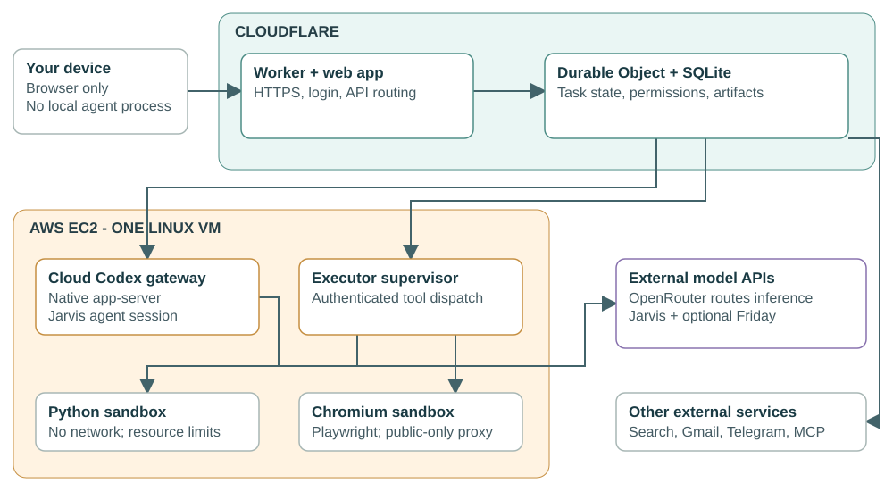

# Architecture: what runs where

The deployed product is a cloud system. A user opens its website from any device; that browser is the interface, not the agent execution host. The optional laptop companion is a separate private-file feature and is not needed for the cloud demo.

Read the complete illustrated [cloud architecture and viva guide](DEMO_VIVA_GUIDE.md). It is the current teaching document and separates deployed features from proposed improvements.

| Responsibility | Running component |
| --- | --- |
| Website, HTTPS and authenticated API | Cloudflare Worker and static web assets |
| Persistent task coordination, policy, messages and current artifacts | Relay Durable Object with SQLite on Cloudflare |
| Jarvis's native agent harness | Codex app-server in Docker on the AWS Linux EC2 host |
| Jarvis and Friday model inference | External models through OpenRouter; not local model serving on EC2 |
| Browser and Python execution | Isolated Docker environments dispatched by the AWS executor supervisor |
| Selected private-file search | Optional paired Python companion on the owner's laptop |
| Host management, persistent disk and optional object storage | AWS SSM/IAM, EBS and S3 |

Current configured models are GPT-6 Luna for Jarvis and DeepSeek V4 Flash for Friday. Friday is optional; automatic duplicate review is off. A previous real Codex report used GPT-5.4-mini, so it must not be represented as a benchmark of the new model pair.

The office persists work before tool execution, checks permission, records the real result and resumes the native agent session. Important outputs become named artifacts with preview/download links. A model proposes actions; deterministic code controls disclosure, roles and consequential sends.

The AWS host currently has fixed runtime shutdown. Demand-driven start/stop, stable tunnel configuration and safe task leases are a proposed next step, explained in section 9 of the guide. No new autoscaling infrastructure has been provisioned as part of that discussion.

For verified outcomes and limits, read [DEMO_STATUS.md](DEMO_STATUS.md), [cloud review](CLOUD_DEMO_REVIEW.md) and [remaining work](REMAINING_WORK.md). Local development commands do not describe production placement.
